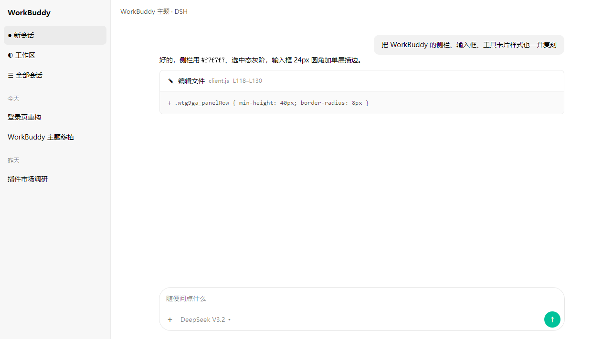

# dsh-workbuddy-theme

把 **腾讯 WorkBuddy 桌面端的视觉**（配色 / 字体排版 / 会话布局）搬到 DSH Web GUI 的主题插件。

只做浅色。不改 DOM、不拦事件、不发请求，移除 `<style>` 节点即完全还原。



## 它复刻了什么

配色、字号、间距不是「看着像」，而是逐项从 WorkBuddy v5.0.2 安装包里量出来的：

- 设计令牌来自 `resources/app.asar` → `/renderer/assets/src-Dml5RbhE.css`（共 1985 个 `--wb-*` 变量）
- 组件规格来自 `.im-conversation-item`、`.wb-cb-chat.light`、`.assistant-message-tool` 等真实规则

| 维度 | WorkBuddy 取值 | 本插件落在 |
| --- | --- | --- |
| 品牌色 | `--wb-palette-brand-8 #00c29a`（薄荷绿） | `--dsw-static-deepseek-500` + `--wb-brand` 1/2/3/7/9/10 阶梯 |
| 灰阶 | `gray-1 #fafafa` → `gray-5 #e6e6e6` | `--wb-gray-1..5` 与 `--dsw-static-neutral-bluish-*` |
| 正文色 | `#000` / `#000000b3` / `#00000080` / `#0000004d` | `--dsw-alias-label-primary/secondary/tertiary/dimmed` |
| 描边 | `color-mix(#000 8%, transparent)` | `--wb-border` + `--dsw-alias-border-l1..l4` |
| 字号刻度 | 12 / 13 / 14 / 16 / 18 | 正文 14px、代码 13px、小字 12px |
| 行高 | 正文 22px | `--wb-lh-body: 22px` |
| 对话栏宽度 | `--cb-chat-max-content-width: 848px`，屏宽 ≥1681px 时 `1008px` | `--dsh-chat-content-width` |
| 侧栏底色 | `--wb-sidebar-bg` = `gray-2 #f7f7f7` | `.wtg9ga_root` |
| 侧栏条目 | 圆角 8px、最小高 40px、左右内边距 8px、14px/22px、选中用灰阶不用品牌色 | `.wtg9ga_panelRow` |
| 用户消息 | 圆角 12px + `#f2f2f2` 浅灰底 | `._bubble_*` + `--dsw-specific-bubble` |
| 助手消息 | **无边框、无底色**，只留白 | 未加任何容器样式 |
| 输入框 | 圆角 24px、单层 `#e6e6e6` 描边、聚焦不变色 | `.GRgSLq_card` |
| 工具卡片 | 圆角 8px、卡头 `12px 16px`、工具名 14px、路径 12px | `.hKdVjq_*` |
| 字体栈 | `PingFang SC, system-ui, -apple-system, BlinkMacSystemFont, Segoe UI, sans-serif` | 同值，追加 `Microsoft YaHei UI` 兜底 |

### 关于字体

WorkBuddy **没有**打包自有中文 UI 字体（asar 里的 `Assistant-*.woff2` 只给 Excalidraw 用），
它「好看」的一半来自 PingFang SC 在 macOS 上的渲染。

Windows 上最接近 PingFang SC 的静默替代是系统自带的 **微软雅黑 UI**（`Microsoft YaHei UI`）——
它和 PingFang 同为「拉丁稍窄 + 中宫较松」的脸，实测 `Em` 宽 1.317em，可以直接顶替，不需要另装字体。
想更进一步，可配 `dsh-fonttune` 换成 HarmonyOS Sans SC 或 MiSans。

## 安装

```bash
# 从 npm（推荐）
dsh plugin --profile <你的 profile> add dsh-workbuddy-theme

# 从 GitHub
dsh plugin --profile <你的 profile> add github:elegant01/dsh-workbuddy-theme

# 从本地目录
dsh plugin --profile <你的 profile> add file:/path/to/dsh-workbuddy-theme
```

装完后**重启应用**（主题是客户端 CSS，刷新页面不一定会重新拉取插件清单）。

## 它做了什么

两件事，各自走宿主提供的正门：

```
index.js          宿主端，只有一个空 apply()，作用是让加载器把插件挂进插件集合
client.js         全部效果所在：令牌叠加 + 一段结构 CSS + 几个槽位上的小部件 + 设置页
cordis.patch.yml  dsh.bundle 清单，声明插件 id 与包名
```

**第一件：配色与字体走 `theme.overrideTokens()`**（约 82 个 `--dsw-static-*` 色阶 +
两个字体令牌，每条都同时给 light / dark 两个值）。

这是 DSH 的官方扩展点，宿主把令牌写成 `<body>` 的内联样式，优先级高于任何 `<style>` 标签。
好处是结构上的：一个令牌同时管明暗，切换配色自动跟随；切走 / 禁用 / 热重载时整层一起回收。
`dsh-theme-native`、`@hmkk/dsh-appearance`、`dsh-fonttune` 三家市场插件都是这么做的。

**第二件：结构与细节靠一段自己的 CSS**（`<style id="dsh-workbuddy-theme-css">`），
因为宿主没有为形状留扩展点。这段 CSS 的值全部引用上面的令牌，所以它随明暗自动切换。
选择器从稳到脆：

1. **改设计令牌**——覆盖 `--dsw-alias-*` / `--dsw-static-*` / `--dsw-font-*`，DSH 升级后基本不会坏
2. **覆盖组件选择器**——**优先用宿主发布的 `data-*` 属性**
   （`[data-composer-card]` / `[data-message-bubble]` / `[data-tool]`），
   只有没有属性的地方才退回带哈希的类名（`.wtg9ga_*` / `.GRgSLq_*` / `.hKdVjq_*`）
3. **不打 DOM 补丁**——不重写结构、不注入元素

侧栏定制带**探测门控**：插件加载时找不到 `.wtg9ga_*`（DSH 升级改了类名）就整段跳过并在控制台告警，
不会把错位的样式硬套上去。配色与字体不受影响。

字体与正文排版也走令牌（`--dsh-font-family-text-default` / `--dsw-font-markdown-base`），
不是锁类名，所以标题、代码、表格的字体栈会一起跟着变。

**第三件：四个宿主槽位上的小部件**（`slots.inject` + `slots.register`，走宿主声明的正门）：

| 槽位 | 内容 |
| --- | --- |
| `settings.section`（order 18） | 设置左侧导航新增一页「WorkBuddy 外观」，含启用开关与已知取舍 |
| `settings.general.item`（order 9.5） | 「通用」页里紧挨「外观」上面的一行主题开关 |
| `sidebar.session.row.trailing` | 会话行时间戳旁一个 6px 低对比圆点 |
| `conversation.session.header.utilities` | 会话标题栏右上角的 WorkBuddy 小胶囊 |
| `conversation.input.dock` | 输入卡上方一条工作区快捷条 |

每个槽位注册都包在 try/catch 里：宿主改版、槽位未声明、条目渲染出错时只跳过该部件，
配色与字体不受影响。设置页与开关只依赖 `theme` 与 `slots` 两个服务，不声明 `store` / `inject`——
宿主对行组件的 `useStore` / `actions` 契约一旦不满足会抛错，行会被错误边界吃掉只剩一个空 div。

## 布局相关

- **对话栏宽度**：覆盖 `.an3WzG_body` 上的 `--dsh-chat-content-width` 兜底值，常规 848px、
  窗口 ≥1681px 时 1008px、≤1080px 时按栏宽 86% 流式收窄。用户拖过的宽度写在
  `--dsh-chat-user-width`，插件不覆盖，拖拽手感不变。
- **输入卡内部分区**：顶部 8px、输入区 `4px 8px 0 14px`、底部工具条 `2px 10px 8px`、间距 10px。
- **工具卡展开态**：展开体最大高度 260px → 320px。

## 更新日志

见 [CHANGELOG.md](CHANGELOG.md)。

## 已知取舍

- DSH 前端类名是 CSS Modules 生成哈希（如 `.wtg9ga_panelRow`）。插件里的选择器**直接写了这些类名**，
  这样最精确、不会误伤；代价是 DSH 大版本升级后如果前缀变了，需要重新对一遍。
  文件里每段都标注了来源（`InputBar_module_css_default`、`SidebarRoot_module_css_default` 等），改起来有据可循。
- DSH 若把 `--dsw-*` 令牌改名，令牌覆盖会失效 —— 页面只是回到原主题，不会坏。
- 深色模式：配色与字体**自动跟随**（同一层同时给了 light / dark 两个值）；
  结构 CSS 的几张卡片（侧栏行高、输入卡圆角、气泡圆角）是形状，不分明暗，两态共用。
- `--dsw-static-neutral-*` 一族共 14 档明暗两值相同 —— WorkBuddy 的灰阶只设计了浅色。
  只用浅色时无影响；若将来认真做深色，这一族需要重新给暗色档位。
- 开关存在 `localStorage`（`dsh-workbuddy-theme:enabled`），默认开启，不用宿主的 configForms ——
  那需要宿主侧声明 schema，而本插件宿主端是故意空的。
- 开关与复选框的勾色由浏览器按填充色亮度自动挑（`accent-color` 只定填充）。填充是品牌薄荷绿，
  中间亮度，勾是黑色。改用 `appearance: none` 自绘白勾试过，但宿主的复选框不止一种 DOM 结构，
  漏掉的那些会变成空框、连勾选态都看不出来，所以宁可保留黑勾。
- 只针对 DSH Web GUI；DSH TUI / headless 不受影响。

## 许可

MIT。WorkBuddy 是腾讯的产品，本项目与其无关联，只是照着它的公开界面做视觉复刻，不含其任何代码或资源。
